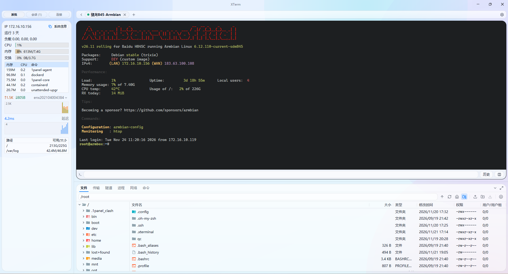
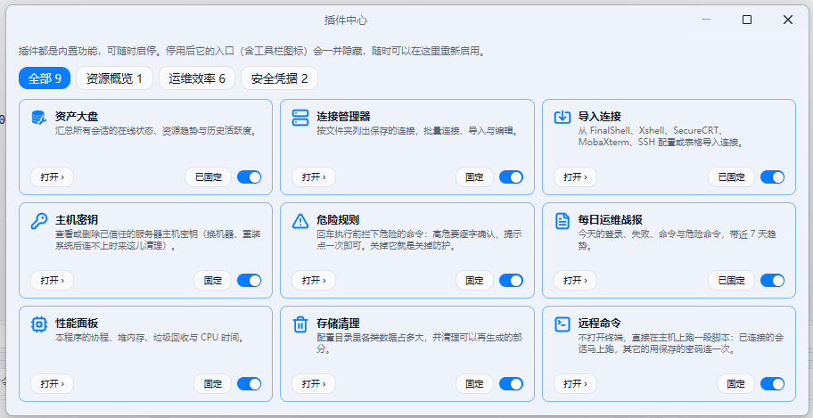
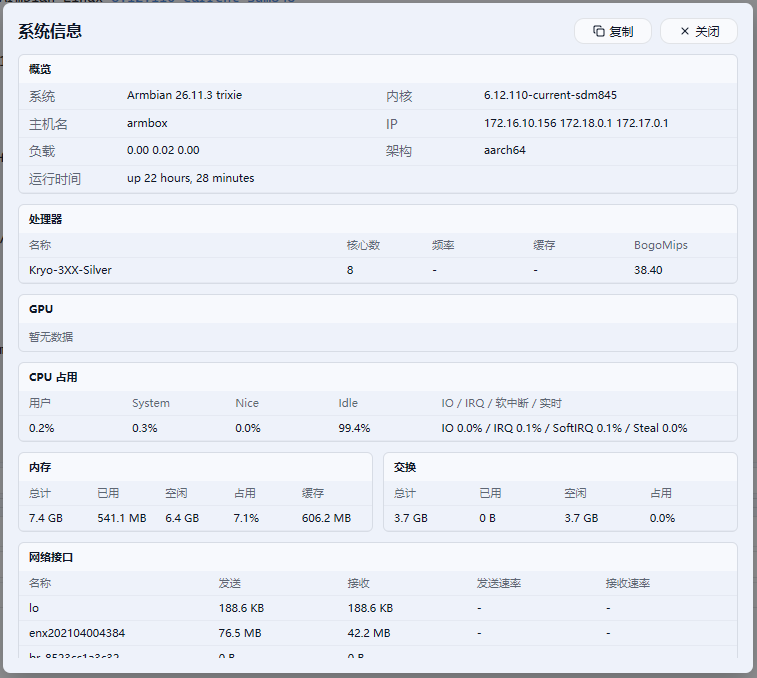
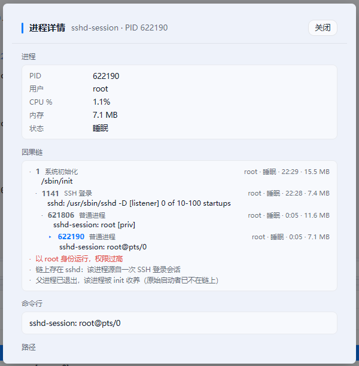
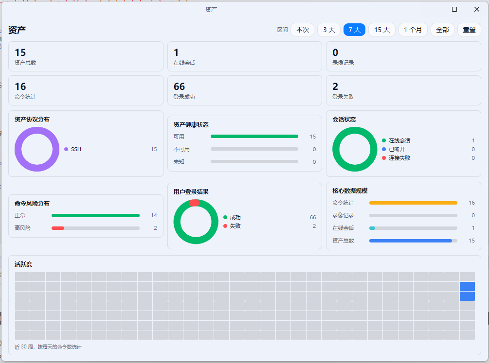

<h1 align="center">
  &nbsp;XTerm
</h1>

<p align="center">
  <b>FinalShell 的顺手，原生程序的速度。</b><br>
  用 Go 和 MyGo 写的 SSH / SFTP 客户端：macOS、Windows、Linux 原生运行，不用装 Java，终端引擎来自 Ghostty。
</p>

<p align="center">
  <a href="https://github.com/HWYWL/XTerm/releases/latest"></a>
  <a href="#安装"></a>
  <a href="#从源码构建"></a>
  <a href="LICENSE"></a>
</p>

<p align="center">
  
</p>

左上是服务器状态，下面是会话，右边是终端，终端下面是服务器上的文件——打开就会用。会话标签收进左下角的竖向列表，可以滚动、可以拖动排序。密码存在系统钥匙串里，从不写进配置文件。

> XTerm 基于开源项目 [FinallyShell](https://github.com/TooonyChen/finallyshell) 二次开发，布局、代码与文档都源自那里，本仓库在其之上修改和新增。问题请提到本仓库，不要提到上游。

## 亮点

| 模块 | 它替你做的事 |
|---|---|
| **连接** | 主窗口里就有连接树，双击开会话；支持 SOCKS5 / HTTP 代理与跳板机（`ssh -J`，可多级，能检测环路），跳板机也可以单独一页来选。从 FinalShell、Xshell、SecureCRT、MobaXterm、`~/.ssh/config`、CSV/Excel 导入连接，也能把连接导出成 JSON。 |
| **终端** | Ghostty 的 libghostty-vt：分屏、查找、选中即复制、几百套配色、背景图片、连字、GBK/GB18030/Big5/Shift_JIS 等编码转换、可改的退格键与快捷键。 |
| **文件** | SFTP 面板跟着终端的 `cd` 走；拖进来就上传，三个传输并行、可续、可打包 tar.gz；内置编辑器有语法高亮、查找替换、多光标、折叠，编码和换行符原样保存。 |
| **监控** | 负载、CPU、内存、磁盘、网速与延迟两张曲线卡片，每 2 秒刷新；进程页可排序筛选，进程详情里一路显示**因果链**——从 init 到目标的每一层父进程与风险提示；网络页看谁在监听、谁连着、各自身份与归属地。 |
| **命令** | 命令输入框带路径与命令补全、历史检索；快捷命令按分组存放、可拖动排序；命令编辑器随手发几行，`Cmd/Ctrl+Enter` 发送选中或全部。 |
| **更多** | 本地终端标签、SSH Agent 认证、会话录制（带时间戳的 transcript）、连接诊断（往返延迟、能连通的端口、服务器自身的 DNS 与路由）、多机同步（gist / WebDAV / S3）、托盘、自动更新、中英双语、浅色深色。 |

<table>
  <tr>
    <td></td>
    <td></td>
  </tr>
  <tr>
    <td></td>
    <td></td>
  </tr>
</table>

每个功能的细节见 [功能说明](docs/zh-CN/features.md)，程序保存的文件见 [配置文件](docs/zh-CN/configuration.md)。

## 安装

在 [Releases](https://github.com/HWYWL/XTerm/releases/latest) 下载，装好就会自己更新：

| 系统 | 文件 |
|---|---|
| macOS（Apple 芯片 / Intel） | `xterm-<版本>-arm64.dmg` / `xterm-<版本>-amd64.dmg` |
| Windows（x64） | `xterm-setup-<版本>-amd64.exe`，或免安装的 `.zip` |
| Debian、Ubuntu（x64 / ARM64） | `xterm_<版本>_amd64.deb` / `xterm_<版本>_arm64.deb` |
| 其他 Linux（x64 / ARM64） | `xterm-<版本>-linux-<架构>.tar.gz`，解压后 `sh install.sh` 装到 `~/.local` |

- **macOS 首次打开被拦下**：还没有公证，拖进“应用程序”后运行 `xattr -dr com.apple.quarantine /Applications/XTerm.app`，或在“系统设置 › 隐私与安全性”里点“仍要打开”。
- **Windows SmartScreen**：安装程序没有签名，点“更多信息”，再点“仍要运行”。
- **Linux**：托盘需要 `libayatana-appindicator3`，记住密码需要 Secret Service 密钥环（GNOME Keyring、KWallet、KeePassXC 等）；没有也能用，密码只留在内存里。
- 想试 main 上的新东西：每次合并会发布一个标为 Pre-release 的预览版，已安装的应用不会自动更新到它。

## 快捷键

默认和 FinalShell 一致，分屏键与 Ghostty / Windows Terminal 一致，全部可以在“选项 › 终端 › 快捷键”里改。

| 操作 | macOS | Windows / Linux |
|---|---|---|
| 在终端里查找 | <kbd>Cmd</kbd>+<kbd>F</kbd> | <kbd>Ctrl</kbd>+<kbd>Shift</kbd>+<kbd>F</kbd> |
| 连接管理器 | <kbd>Cmd</kbd>+<kbd>O</kbd> | <kbd>Ctrl</kbd>+<kbd>Shift</kbd>+<kbd>O</kbd> |
| 新标签页 | <kbd>Cmd</kbd>+<kbd>T</kbd> | <kbd>Ctrl</kbd>+<kbd>Shift</kbd>+<kbd>T</kbd> |
| 命令输入框，再按回到终端 | <kbd>Cmd</kbd>+<kbd>Shift</kbd>+<kbd>L</kbd> | <kbd>Ctrl</kbd>+<kbd>Shift</kbd>+<kbd>L</kbd> |
| 显示或隐藏底部面板 | <kbd>Cmd</kbd>+<kbd>J</kbd> | <kbd>Ctrl</kbd>+<kbd>Shift</kbd>+<kbd>J</kbd> |
| 会话 / 连接两页切换 | <kbd>Cmd</kbd>+<kbd>Shift</kbd>+<kbd>E</kbd> | <kbd>Ctrl</kbd>+<kbd>Shift</kbd>+<kbd>E</kbd> |
| 向右 / 向下分屏 | <kbd>Cmd</kbd>+<kbd>D</kbd> / <kbd>Cmd</kbd>+<kbd>Shift</kbd>+<kbd>D</kbd> | <kbd>Alt</kbd>+<kbd>Shift</kbd>+<kbd>=</kbd> / <kbd>-</kbd> |
| 放大分屏 | <kbd>Cmd</kbd>+<kbd>Shift</kbd>+<kbd>Enter</kbd> | <kbd>Ctrl</kbd>+<kbd>Shift</kbd>+<kbd>X</kbd> |
| 关闭分屏 / 标签 | <kbd>Cmd</kbd>+<kbd>W</kbd> | <kbd>Ctrl</kbd>+<kbd>Shift</kbd>+<kbd>W</kbd> |
| 切换标签 | <kbd>Cmd</kbd>+<kbd>1</kbd>…<kbd>9</kbd>，<kbd>Cmd</kbd>+<kbd>[</kbd> / <kbd>]</kbd> | <kbd>Alt</kbd>+<kbd>1</kbd>…<kbd>9</kbd>，<kbd>Ctrl</kbd>+<kbd>Tab</kbd> |

## 更新日志

XTerm 有自己的版本号，从 0.0.1 开始；上游 FinallyShell 的版本独立演进。下面只展开最新一版，旧版收在折叠块里。

### v0.2.2 <sub>最新</sub>

- AI 标签页把每个回答按它写的页面显示：标题、列表、引用和表格，代码块带语言和复制按钮，段落里的粗体、斜体、行内代码和链接。
- 回答还在生成时也照样显示：没闭合的代码块一直显示到末尾，没闭合的标记保留原文。
- 回答再长也在输入框上方滚动：输入框、发送按钮和新建对话按钮留在面板里，不再被顶到面板外面。

<details>
<summary><b>v0.2.1</b></summary>

- 新增 AI 助手，回答服务器相关的问题。“选项 › AI”里选择 OpenAI 兼容的服务（已内置 DeepSeek、OpenAI、Kimi、GLM、SiliconFlow 和 Ollama）、模型和 API Key，以及助手能做什么。
- 每个会话在底部面板“命令”之后都有自己的 AI 标签页：每个标签、每台服务器各有一份对话，互不混杂。
- 回答边生成边显示，连同模型的思考过程；可以复制、重新生成，或插入终端执行。
- 允许执行命令时，助手会在会话的主机上运行只读命令，读取监控快照和文件面板当前目录；默认每条命令都要确认，并且在独立通道执行，不打扰终端。
- 输入框按 Enter 发送，按 Ctrl+Enter 换行，发送按钮就在输入框末尾。
- 会话右键菜单可以录制终端记录，“选项 › 录制”可以让每个会话连接时自动开始；录制文件在选项里打开或删除。
- 会话右键菜单还能诊断连接：往返延迟、本机可达的端口，以及服务器自己的 DNS 和路由结果。
- 连接编辑器里跳板机有了独立页面，显示连接经过的跳转链。
- 连接管理器的菜单可以把保存的连接导出为 JSON，包含文件夹和主机，不含密码。
- 进程详情显示它的来源链：从 init 一路到该进程，每一步的命令。
- 断线的终端会保留最后的画面和历史，而不是变成空白，随时可以重连。
- 文件列表的列可以点表头排序。

</details>

<details>
<summary><b>v0.1.1</b></summary>

- 监控里的网络和延迟改成两张卡片：平滑曲线与淡填充、上下行速率、网卡速率、今日流量，以及每张图的峰值和时长。
- CPU、内存、磁盘和交换的进度条与圆环换新配色：蓝、紫、绿、灰。
- 去掉了监控里的进程 TOP 5，进程页里有全部进程。
- 监控支持 macOS：系统面板、进程列表和进程详情分别读 `ps`、`vm_stat`、`netstat` 和 `df`。
- `ps` 列不出所有进程时（如 OpenWrt 的 BusyBox），改用 `/proc` 列出，进程页不再是空的。
- 双击进程或右键“打开详情”，在对话框里看进程、命令行、路径，并复制、降低优先级或发送信号。
- 菜单里的每个信号都注明作用：优雅退出、强制结束、重载配置、中断、暂停、恢复。
- 终端文本高亮：按规则给日志级别、IP、时间、权限、大小、链接、关键词和数字着色，预设可开关，也能自己加规则。

</details>

<details>
<summary><b>v0.0.1</b> · 第一个版本</summary>

- XTerm 的第一个版本，基于 FinallyShell 二次开发：服务器监控、左侧面板里的会话和保存的连接、支持分屏的终端、SFTP 远程文件、快捷命令、命令输入框、隧道、同步和连接导入。
- “选项 › 关于”里显示版本，并检查本仓库的 Releases 进行更新。
- 应用名改为 XTerm，使用新的图标；旧名称下保存的设置和密码会自动沿用。

</details>

完整的中英文对照在 [CHANGELOG.md](CHANGELOG.md)，全部版本见 [Releases](https://github.com/HWYWL/XTerm/releases)。main 上已经合入、尚未发布的改动，会随下一个版本出现在这里。

## 常见问题

**监控面板一直是空的？** 监控读 `/proc`，只支持 Linux 和 macOS。有些跳板机不允许额外通道，可以在主机的设置里关掉“启用 exec 通道（服务器监控）”。

**主机和密码存在哪里？** 主机与设置是用户配置目录里的 JSON（macOS 在 `~/Library/Application Support/XTerm`，Windows 在 `%AppData%\XTerm`，Linux 在 `~/.config/XTerm`），密码在系统钥匙串里，服务名是 `xterm`。

**支持 Telnet、RDP 或串口吗？** 不支持，只有 SSH 和 SFTP。

## 从源码构建

需要 Go 1.27.3 或更新的版本：

```bash
git clone https://github.com/HWYWL/XTerm.git
cd XTerm && go tool mygo dev     # 改了代码自动重启
go tool mygo build               # 打包到 build/<平台>/
```

第一次运行会把 libghostty-vt 下载到用户缓存目录。测试、发布与代码结构见 [开发说明](docs/zh-CN/development.md)。

## 参与贡献

欢迎 issue 和 pull request。每个改动先开一个 issue 说清楚打算怎么做，细节与贡献条款见 [CONTRIBUTING.md](CONTRIBUTING.md)。

## 致谢

感谢 [FinallyShell](https://github.com/TooonyChen/finallyshell)：XTerm 只是站在它肩上的一版重写。

## 许可证

XTerm 公开源码，但不是 OSI 定义的开源软件。下面两个许可证任选其一（全文见 [LICENSE](LICENSE)）：

- [PolyForm Noncommercial 1.0.0](https://polyformproject.org/licenses/noncommercial/1.0.0)：任何非商业用途，包括 fork、修改和分享。
- [PolyForm Internal Use 1.0.0](https://polyformproject.org/licenses/internal-use/1.0.0)：你自己或你的公司内部使用，可以修改，但不能对外分发。

出售本软件、放进收费产品、以商业目的分发修改版等，需要另外取得商业授权，请开 issue 联系。
